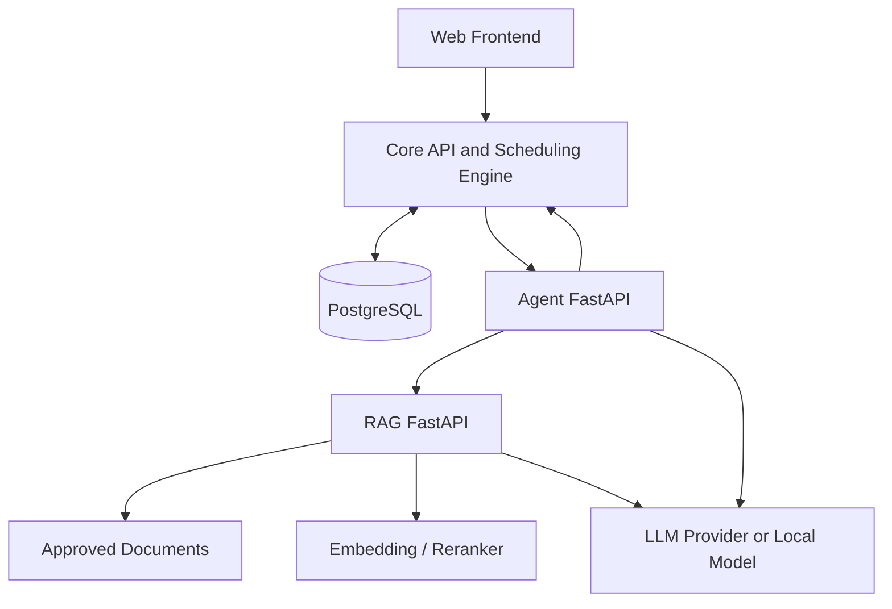

# CampusCue Context and Architecture

## 1. Context boundary

CampusCue coordinates organizer workflows around events. It can store proposals and organizer-reported requests, but institutional status is authoritative only when verified evidence comes from an authorized source.

External systems and sources:
- OSA Student Affairs Handbook and other approved policy documents.
- Campus event pages and verified facility/service information.
- Official booking or calendar system, only if access is authorized and integration is approved.
- Student-selected Google Calendar, using read-only access only when the student connects it.
- Mock attendance and timetable providers for the MVP. An institutional academic-record API is not assumed.
- Human organizers and authorized administrators.
- Optional LLM/embedding/reranking providers.

## 2. Logical architecture

## 3. Service ownership

### Core API
Owns operational records and decisions:
- identity/authorization integration;
- clubs, memberships, events, resources;
- event publication, internal registrations, and external-registration redirects;
- student-private timetable, academic-calendar, and mock-attendance records used for registration-risk checks;
- schedule validation and transaction-safe conflict prevention;
- event revisions, commitments, evidence references, dependencies, tasks;
- scoped administrator overrides and audit history;
- verified data assembly for reports.

### Agent API
Owns reasoning orchestration for one interaction:
- natural-language intent extraction;
- tool selection and bounded execution;
- calling Core API and RAG;
- explaining structured results;
- producing action drafts and report text;
- trace and structured response output.

It does not own persistent event state or grant permissions. Tool authorization is enforced by Core API.

### RAG API
Owns document knowledge:
- authorized source registry and ingestion;
- parsing, chunking, metadata, document versions;
- sparse and dense indexes;
- hybrid retrieval, fusion, optional reranking;
- source excerpts, page citations, grounded answers and abstention.

It does not decide current event status or venue availability.

### Frontend
Owns interaction and presentation only. It cannot be the enforcement point for scheduling, permissions or status transitions.

The frontend has separate organizer and student views. The student event feed includes only events that an organizer explicitly published to that audience. Private planning records, commitments, evidence, calendar data, timetable data, attendance values, and registration-risk warnings never appear in organizer views.

## 4. Trust boundaries
- Browser → Core API: authenticated public application boundary.
- Core API → Agent/RAG: private service-to-service boundary.
- Agent → tools: allowlisted typed operations; no arbitrary shell/SQL/network tool.
- RAG document text → model: untrusted content. Text cannot override system/tool policy.
- Official confirmation: trusted only when actor/source authorization and evidence checks pass.
- External LLM/embedding provider: data egress boundary; avoid sending private data unless explicitly approved.
- Student academic data: private boundary. The Core API returns academic-risk results only to the authenticated student and does not send calendar titles, timetable entries, attendance values, or risk details to organizers, Agent, or RAG.

## 4.1 Student registration-risk flow
1. An organizer publishes an event with a student audience and one registration mode: internal, external, or none.
2. A student lists published events and opens an event detail page.
3. Before registration or external redirect, the Core API evaluates the event interval against the student's seeded or connected academic-calendar events, timetable, and mock attendance snapshot.
4. Core returns private advisory warnings for direct exam conflicts, next-day exams, and class overlaps with attendance context.
5. The student chooses to continue or cancel. Warnings do not make an academic eligibility decision.
6. Internal registration creates a registration record. External mode records only that the student was redirected; it does not claim the external form was completed.

## 5. Event change flow
1. User submits proposed changes with the current event revision.
2. Core validates permissions and checks schedule constraints.
3. Dependency engine finds commitments/tasks tied to changed fields.
4. Core returns deterministic impacts and items needing revalidation.
5. Agent explains the impact and drafts follow-ups.
6. User reviews.
7. Core applies the authorized mutation transactionally, creates a revision and audit record, and marks affected commitments as needing revalidation where appropriate.

The agent must not apply a change based on stale event data. Mutations should include expected revision/version.

## 6. Scheduling invariants
- Intervals are timezone-aware and normalized to UTC for persistence.
- Campus display timezone is `Asia/Kolkata`.
- Event intervals use `[start, end)` semantics.
- Start must be strictly before end.
- Same-venue confirmed intervals may not overlap unless an explicitly authorized `VENUE_OVERLAP` override is recorded.
- The configured campus-wide gap is 120 minutes between consecutive events; exactly 120 minutes passes.
- The gap rule's institutional validity must be verified. Until then, describe it as a CampusCue planning rule, not official university policy.
- A `CAMPUS_GAP` override never implicitly overrides a `VENUE_OVERLAP` conflict.
- Conflict validation must be repeated inside the write transaction.
- Empty event results never establish that a venue is available.

## 7. RAG pipeline
Authorized sources → parse with page/section metadata → structure-aware chunks → sparse retrieval + dense retrieval → RRF fusion → optional reranking → access-filtered context selection → grounded answer → citations and abstention flag.

Suggested first implementation:
- PostgreSQL full-text search for sparse retrieval.
- `pgvector` for dense retrieval.
- RRF for fusion.
- Cross-encoder reranking only after a baseline is measured.
- A reviewed 30–50-question evaluation set.

## 8. Deployment
Docker Compose can run:
- `web` on host port 3000;
- `core-api` on 8000;
- `agent-api` on 8001;
- `rag-api` on 8002;
- `postgres` on 5432.

For development, ports 8001 and 8002 may be published to localhost for direct testing. In integrated or production environments, keep Agent and RAG on a private network. Never expose administrative ingestion or internal tools without authentication.

## 9. Failure behavior
- Agent unavailable: core event CRUD and scheduling remain usable; policy/agent features show unavailable state.
- RAG unavailable: agent must not invent policy answers; return an explicit dependency error or ask the user to retry.
- LLM unavailable: deterministic APIs still work; retrieval-only search can still work if embedding/search dependencies are available.
- Missing/unclear source: RAG returns insufficient evidence.
- Conflict checker unavailable: do not confirm or commit a schedule mutation that requires validation.
- Stale revision: reject mutation with a conflict response and require refresh/review.
- Unknown venue availability: present as unknown, not free.
- Academic data unavailable: registration remains possible and the student sees that no academic-risk check could be completed.

## 10. Observability
Propagate `request_id`/correlation ID across Core, Agent and RAG. Log request metadata, tool name, latency, outcome, model/index version and error category. Do not log secrets, private conversation exports, full sensitive document bodies, or unrestricted user prompts by default.
