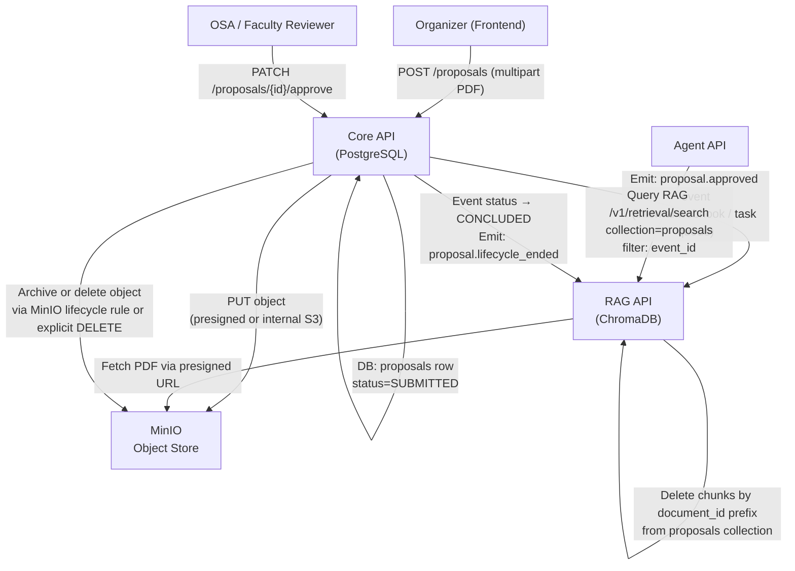

# Implementation Plan 07 — Proposal Storage & RAG Lifecycle

> **Status:** PLAN — Decisions confirmed 2026-10-11. No implementation has been done yet.
> **Scope:** MinIO object storage for event proposals + approval-gated RAG ingestion + lifecycle deletion.
> **Services touched:** Core API, RAG API, (optionally Agent API for queries).
> **Prerequisites:** Plan 00 (contracts), Plan 01 (Core event model), Plan 02 (RAG ingestion pipeline).

### ✅ Confirmed Decisions (locked)

| Decision | Resolution |
|---|---|
| MinIO credentials in RAG API | ❌ **Never** — RAG API uses per-request presigned URLs from Core API only |
| ChromaDB collection strategy | **Separate `proposals` collection** — isolated from `policy_corpus` |
| Chunk deletion timing | **24 hours after event status → `CONCLUDED`** — scheduled cleanup job |
| Object retention | **Archive only** — objects moved to cold prefix; no hard deletes ever |

---

## 1. Problem Statement

Club organizers will upload event proposals (PDF) before organizing an event. These proposals need to:

1. Be stored durably so reviewers (OSA / faculty) can read them.
2. Only enter the RAG index **after** an authorized reviewer approves them — never on upload alone.
3. Be queryable by the organizer and OSA (e.g. "what did we propose for the venue?") while the event is live.
4. Be automatically cleaned up (chunks deleted, object archived) once the event lifecycle ends.

The LLM must **never** be the authority on approval status. Ingestion is gated by a deterministic state transition in Core API.

---

## 2. Architecture Overview



---

## 3. MinIO Bucket Structure

### 3.1 Bucket naming

One dedicated bucket per deployment environment:

```
campuscue-proposals-{env}
  e.g. campuscue-proposals-dev
       campuscue-proposals-prod
```

No per-club buckets — access control is enforced at the **object key** level and via Core API authorization, not bucket-level IAM.

### 3.2 Object key convention

```
proposals/{club_id}/{event_id}/{proposal_id}/v{revision}.pdf
```

Examples:
```
proposals/club-ieee/evt-2025-techfest/prop-001/v1.pdf
proposals/club-ieee/evt-2025-techfest/prop-001/v2.pdf   ← revision after feedback
proposals/club-nss/evt-2025-camp/prop-002/v1.pdf
```

**Why this layout:**
- `club_id` at root → easy IAM policy scoping per club if needed later.
- `event_id` nesting → all proposals for one event are co-located, easy bulk archive/delete.
- `proposal_id` is the Core API UUID for this proposal record.
- `v{n}` explicit revision suffix → multiple rounds of submission without overwriting.

### 3.3 Object metadata (stored as MinIO object tags/user-metadata)

```
x-amz-meta-club-id:      club-ieee
x-amz-meta-event-id:     evt-2025-techfest
x-amz-meta-proposal-id:  prop-001
x-amz-meta-revision:     1
x-amz-meta-submitted-by: user-abc123
x-amz-meta-status:       SUBMITTED
```

Metadata is informational only — **authoritative status lives in PostgreSQL**, not MinIO tags.

---

## 4. Core API Data Model

### 4.1 New `proposals` table

```
proposals
  id              UUID PK
  event_id        UUID FK → events.id
  club_id         UUID FK → clubs.id
  submitted_by    UUID FK → users.id
  revision        INTEGER NOT NULL DEFAULT 1
  status          proposal_status_enum NOT NULL
  minio_bucket    TEXT NOT NULL
  minio_key       TEXT NOT NULL          ← full object key
  file_size_bytes BIGINT
  sha256_hash     TEXT                   ← integrity check
  submitted_at    TIMESTAMPTZ NOT NULL DEFAULT now()
  reviewed_by     UUID FK → users.id NULLABLE
  reviewed_at     TIMESTAMPTZ NULLABLE
  review_note     TEXT NULLABLE
  rag_ingested_at TIMESTAMPTZ NULLABLE   ← set when RAG confirms chunk upsert
  rag_deleted_at  TIMESTAMPTZ NULLABLE   ← set when RAG confirms chunk deletion
  created_at      TIMESTAMPTZ NOT NULL DEFAULT now()
  updated_at      TIMESTAMPTZ NOT NULL DEFAULT now()
```

### 4.2 `proposal_status_enum` lifecycle

```
DRAFT          → organizer saved but not submitted (future: autosave)
SUBMITTED      → uploaded, awaiting review
UNDER_REVIEW   → reviewer opened the proposal (optional transition)
APPROVED       → authorized reviewer approved → triggers RAG ingestion
REJECTED       → reviewer rejected → never ingested into RAG
REVISION_REQUESTED → reviewer asks for changes → new revision upload expected
CHUNKED        → RAG API confirmed successful ingestion
ARCHIVED       → event concluded, chunks deleted, object moved to cold tier
```

> [!IMPORTANT]
> `APPROVED` is a Core API state transition. It requires an authorized actor (`reviewed_by` must be a user with OSA/faculty role, verified by Core API's authorization layer — never the LLM or frontend alone).

---

## 5. API Surface (Core API)

### 5.1 Upload proposal

```
POST /v1/clubs/{club_id}/events/{event_id}/proposals
Content-Type: multipart/form-data

Body:
  file: <PDF binary>
  title: "Techfest 2025 Event Proposal"
  description: "..."

Response 201:
  {
    "id": "prop-001",
    "status": "SUBMITTED",
    "revision": 1,
    "minio_key": "proposals/club-ieee/evt-2025-techfest/prop-001/v1.pdf",
    "submitted_at": "..."
  }
```

Core API uploads the binary to MinIO internally — the frontend never gets a direct MinIO URL or credentials.

### 5.2 Get download URL (presigned)

```
GET /v1/proposals/{proposal_id}/download-url
→ 302 or { "url": "<presigned URL, TTL 15 min>" }
```

Only accessible to: the submitting organizer, club admins, OSA reviewers, and system services (RAG API). Presigned URL expires in 15 minutes.

### 5.3 Approve proposal (OSA / faculty only)

```
PATCH /v1/proposals/{proposal_id}/status
Body: { "action": "approve", "review_note": "..." }

→ Core API: transitions status SUBMITTED → APPROVED
→ Emits internal ingestion trigger to RAG API
```

Reject, request revision, etc. follow the same PATCH endpoint with different `action` values.

### 5.4 Submit new revision

```
POST /v1/proposals/{proposal_id}/revisions
Content-Type: multipart/form-data
Body: file: <PDF>

→ Creates new object at v{n+1}, creates new DB revision row with status=SUBMITTED
→ Previous revision row is not deleted (audit trail)
```

---

## 6. RAG Ingestion Trigger

### 6.1 How Core API notifies RAG API

**Option A — Internal HTTP webhook (MVP, recommended):**
Core API calls `POST http://rag-api/v1/ingest/proposal` synchronously (or fire-and-forget with timeout). If RAG API is unavailable, Core API logs the failure and retries on next health check cycle (simple polling table in DB).

**Option B — Task queue (production scale):**
Core API enqueues a `proposal.approved` job to a Redis queue / Celery / ARQ. RAG API worker picks it up. Better for large files and network partitions but adds infrastructure complexity.

**Decision for MVP:** Use Option A (direct internal HTTP call). The `proposals` table's `rag_ingested_at` column is the idempotency key — RAG API checks it, Core API sets it on confirmation.

### 6.2 Ingestion request payload (Core API → RAG API)

```json
POST /v1/ingest/proposal
{
  "proposal_id": "prop-001",
  "event_id": "evt-2025-techfest",
  "club_id": "club-ieee",
  "revision": 1,
  "minio_bucket": "campuscue-proposals-dev",
  "minio_key": "proposals/club-ieee/evt-2025-techfest/prop-001/v1.pdf",
  "presigned_url": "<15-min URL>",
  "title": "Techfest 2025 Event Proposal",
  "submitted_by": "user-abc123",
  "approved_by": "faculty-xyz"
}
```

RAG API fetches the PDF using the `presigned_url` (no need to hold MinIO credentials in RAG API — avoids credential sprawl).

### 6.3 RAG API ingestion steps

1. Download PDF bytes from `presigned_url`.
2. Parse with `PDFParser` → `List[ParsedPage]`.
3. Chunk with `StructureChunker(target_chunk_size=180, chunk_overlap=30)`.
4. Embed with local `bge-base-en-v1.5` (768d).
5. Generate sparse SPLADE vectors.
6. Upsert all chunks into ChromaDB **`proposals` collection** (separate from `policy_corpus`):
   - Chunk ID format: `proposal-{proposal_id}-v{revision}-p{page}-c{idx:02d}`
   - Metadata on each chunk: `event_id`, `club_id`, `proposal_id`, `revision`, `title`, `approved_by`, `page`
7. Respond `200 { "chunks_ingested": N }` to Core API.
8. Core API sets `rag_ingested_at = now()`, status → `CHUNKED`.

---

## 7. ChromaDB Collection Strategy

### Two separate collections

| Collection | Contents | Retrieval scope |
|---|---|---|
| `policy_corpus` | OSA handbook, ICTS pages, campus infrastructure docs | Global — any query |
| `proposals` | Approved event proposal PDFs | **Scoped by `event_id`** — only the organizer's event |

### Why separate?

- **Access control:** A student querying the policy corpus must never accidentally get chunks from another club's private proposal.
- **Deletion isolation:** When event concludes, only `proposals` collection chunks for that `event_id` are deleted — `policy_corpus` is untouched.
- **Hybrid fusion:** Retrieval route can query both collections and merge results when the user is authorized for that event, or query only `policy_corpus` for general campus policy questions.

### Filter pattern for proposal queries

```python
chroma_collection.query(
    query_embeddings=[...],
    where={"event_id": {"$eq": "evt-2025-techfest"}},
    n_results=10,
)
```

Only chunks whose metadata `event_id` matches the authorized event are returned.

---

## 8. Access Control Rules

| Actor | Can upload | Can view proposal | Can approve | Can query RAG chunks |
|---|---|---|---|---|
| Club organizer (own event) | ✅ | ✅ own revisions | ❌ | ✅ own event only |
| Club admin (own club) | ✅ | ✅ own club | ❌ | ✅ own club events |
| OSA / faculty reviewer | ❌ (read-only) | ✅ all | ✅ | ✅ all events |
| Other clubs | ❌ | ❌ | ❌ | ❌ |
| System (RAG API) | ❌ (no direct upload) | ✅ via presigned URL | ❌ | — |

> [!CAUTION]
> RAG API receives a **short-lived presigned URL** from Core API. It holds no long-lived MinIO credentials. This prevents credential sprawl and means RAG API cannot access arbitrary objects — it can only fetch what Core API explicitly authorizes per ingestion request.

---

## 9. Lifecycle & Deletion

### 9.1 Lifecycle state machine

```
DRAFT → SUBMITTED → UNDER_REVIEW ─┬→ APPROVED → CHUNKED ─→ ARCHIVED
                                   ├→ REJECTED
                                   └→ REVISION_REQUESTED → SUBMITTED (new revision)
```

### 9.2 Deletion trigger — when does cleanup happen?

**Trigger:** Event status in Core API transitions to `CONCLUDED` (after organizer submits the event completion report and OSA acknowledges).

A scheduled background job in Core API runs every hour and finds all events that:
- Have been in `CONCLUDED` status for **≥ 24 hours**, AND
- Have proposals in `CHUNKED` status (i.e. chunks exist in RAG API)

For each such proposal, Core API emits `proposal.lifecycle_ended` to RAG API to delete the chunks, then archives the MinIO object.

This 24-hour window lets organizers query their proposal content while writing the immediate post-event completion report, without requiring a manual trigger.

### 9.3 RAG API chunk deletion

```
DELETE /v1/ingest/proposal/{proposal_id}
Body: { "event_id": "evt-2025-techfest" }
```

RAG API deletes all chunks in the `proposals` collection where metadata `proposal_id = {proposal_id}` AND `event_id = {event_id}`. Responds `200 { "chunks_deleted": N }`.

Core API records `rag_deleted_at = now()` and status → `ARCHIVED`.

### 9.4 What happens to the MinIO object after chunk deletion?

**Confirmed: Archive only — no hard deletes.**

After RAG API confirms chunk deletion, Core API archive-moves the object:

```
Source:      proposals/{club_id}/{event_id}/{proposal_id}/v{n}.pdf
Destination: proposals-archive/{club_id}/{event_id}/{proposal_id}/v{n}.pdf
```

Archive-move is a MinIO server-side copy followed by a delete of the source key — the bytes are never destroyed. The `proposals-archive` bucket can have a MinIO lifecycle rule to transition to a cold storage class after 90 days if the deployment supports tiered storage.

Core API records `rag_deleted_at = now()` and sets status → `ARCHIVED` once both the RAG chunk deletion and the MinIO archive-move succeed.

### 9.5 Rejected and never-chunked proposals

- If status is `REJECTED` or `REVISION_REQUESTED`, **no chunks were ever created** in RAG API.
- Only the MinIO object exists. Core API archives the object on event conclusion using the same archive-move logic.
- No RAG deletion call needed for these.

---

## 10. Revision Handling

| Question | Decision |
|---|---|
| Can an organizer submit multiple revisions? | Yes. Each is a new DB row with incremented `revision`, new MinIO object at `v{n}`. |
| Are older approved revisions re-chunked? | No. Only the **latest approved** revision is chunked. If a revision is approved and then a new revision is submitted, the old chunks stay until explicitly replaced on approval of the new revision. |
| How are old chunks replaced? | On approval of revision N+1, RAG API deletes chunks for revision N (filter: `proposal_id + revision = N`) before ingesting revision N+1. |
| What if the event already has `CHUNKED` status and a new revision is submitted? | Status reverts to `SUBMITTED` for the new revision. The old revision's chunks remain until the new revision is approved. |

---

## 11. Decisions — Resolved & Remaining Open

### ✅ Resolved

| # | Decision | Resolution |
|---|---|---|
| D3 | MinIO auth for RAG API | Presigned URL per-request — RAG API holds zero MinIO credentials |
| D5 | Hard delete vs archive | **Archive only** — cold-prefix move; bytes never destroyed |
| D2 | Deletion trigger timing | **24 hours after `CONCLUDED`** — hourly cleanup job |
| D6 | ChromaDB collection | **Separate `proposals` collection** — never mixed with `policy_corpus` |

### ⏳ Still Open (need product decision before implementation)

| # | Decision | Options |
|---|---|---|
| D1 | Who can query proposal RAG chunks? | (a) Submitting organizer + OSA only; (b) all club members for that event |
| D4 | Cross-event proposal queries for OSA | Can OSA query across all events' proposals at once? Scope unclear for pilot |

---

## 12. Implementation Slices (When Ready to Build)

> **Note:** This is planning only. Slices below define the future implementation order — do NOT start until confirmed.

| Slice | Files (2–3) | Description |
|---|---|---|
| S1 | `contracts/proposals.yaml` + `contracts/rag_ingest.yaml` | OpenAPI schemas for proposal upload, status patch, RAG ingest/delete endpoints |
| S2 | `apps/core/models/proposal.py` + migration | `proposals` table, `proposal_status_enum`, FK to events/clubs |
| S3 | `apps/core/services/minio_client.py` + `tests/core/test_minio_client.py` | MinIO boto3/minio-py wrapper: upload, presigned URL generation, archive-move |
| S4 | `apps/core/api/proposals.py` + `tests/core/test_proposals_api.py` | Core API routes: POST upload, GET download-url, PATCH status, POST revision |
| S5 | `apps/core/services/proposal_lifecycle.py` + `tests/core/test_proposal_lifecycle.py` | State machine transitions, ingestion trigger dispatch, deletion trigger dispatch |
| S6 | `services/rag-api/app/api/routes/ingest_proposal.py` + `tests/integration/test_ingest_proposal.py` | RAG API: POST /v1/ingest/proposal, DELETE /v1/ingest/proposal/{id}, proposals ChromaDB collection |
| S7 | `services/rag-api/app/retrieval/` updates + route filter | Add `event_id` metadata filter to hybrid search for proposals collection |
| S8 | `docs/PROPOSAL_UPLOAD_RUNBOOK.md` | Operational runbook: bucket setup, MinIO credentials, lifecycle rules, manual recovery |

---

## 13. Infrastructure Notes

### MinIO deployment (Docker Compose, local dev)

```yaml
minio:
  image: minio/minio:latest
  command: server /data --console-address ":9001"
  environment:
    MINIO_ROOT_USER: campuscue_admin
    MINIO_ROOT_PASSWORD: <secret — env file only, never committed>
  ports:
    - "9000:9000"   # S3 API
    - "9001:9001"   # MinIO Console UI
  volumes:
    - minio_data:/data
```

### Bucket initialization (startup script)

```bash
mc alias set local http://localhost:9000 $MINIO_ROOT_USER $MINIO_ROOT_PASSWORD
mc mb local/campuscue-proposals-dev
mc mb local/campuscue-proposals-archive-dev
mc anonymous set none local/campuscue-proposals-dev  # no public access
```

### Core API environment variables

```env
MINIO_ENDPOINT=minio:9000
MINIO_ACCESS_KEY=<service account key>
MINIO_SECRET_KEY=<secret — env file only>
MINIO_PROPOSAL_BUCKET=campuscue-proposals-dev
MINIO_ARCHIVE_BUCKET=campuscue-proposals-archive-dev
MINIO_USE_SSL=false    # true in production
```

RAG API holds **no** MinIO credentials. It only receives presigned URLs from Core API.

---

## 14. Security Checklist

- [ ] Core API validates file is a valid PDF (magic bytes check + size limit, e.g. ≤ 25 MB) before uploading to MinIO.
- [ ] Presigned URLs are single-use intent (15-min TTL, generated fresh per request).
- [ ] RAG API validates the presigned URL host matches the configured MinIO endpoint — prevents SSRF via crafted presigned URL from a compromised Core API.
- [ ] `approved_by` user ID is verified server-side against OSA/faculty role before status transition — never trusted from the client.
- [ ] MinIO buckets have no public access policy (`anonymous = none`).
- [ ] RAG chunk metadata never stores raw PDF bytes or PII beyond what's in the approved proposal text.
- [ ] Proposal content from RAG chunks must never appear in Agent responses to users who are not authorized for that event (authorization filter enforced in Core API before calling Agent).

---

## 15. Out of Scope for This Plan

- Real-time collaborative proposal editing (Google Docs-style).
- Digital signatures or tamper-evident sealing of proposals.
- Automated proposal quality scoring by AI (the LLM must not approve proposals).
- Integration with the university's official document management system.
- Multi-tenant / multi-university deployment.
