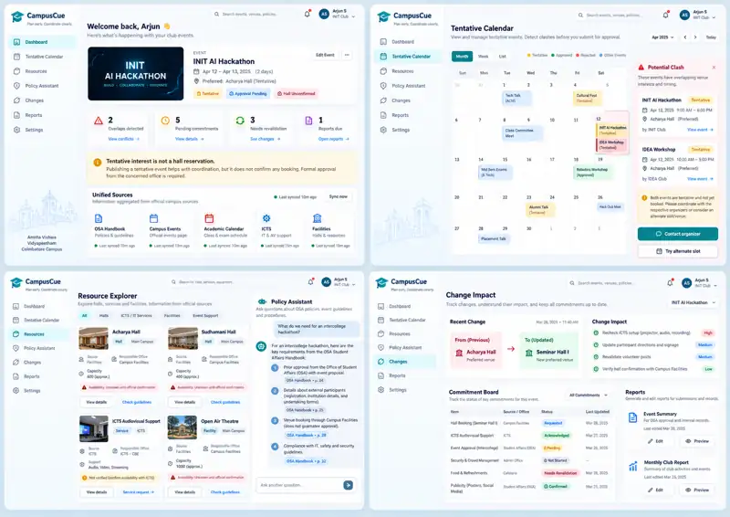

# CampusCue
### An AI-assisted event operations workspace for university clubs

**Project status:** Idea and planning stage · **Pilot campus:** Amrita Vishwa Vidyapeetham, Coimbatore · **Hackathon:** Genesis

CampusCue helps student clubs plan events **before approvals arrive**, discover campus facilities and processes, coordinate overlapping event intentions, and keep everyone aligned when plans change.

It is **not** an official venue-booking portal, a replacement for Student Affairs, or another generic club directory.

## UI Concept Mockup

*Concept visualization only. Dates, event listings, capacities, policy citations, sync indicators and approval statuses shown in the image are illustrative, not verified live Amrita data. The actual product must display source-backed facts and mark unverified information clearly.*

---

## 1. The problem

Organizing even a small university event means coordinating different people, approvals, facilities, documents and responsibilities. At Amrita, information exists across the OSA handbook, campus websites, conversations, emails, forms and previous organizers.

We've experienced these problems while organizing INIT events, including Hacktoberfest Hack Day:

- **Early scheduling clashes.** Multiple clubs may want the same day or hall, but the Events Department cannot confirm the venue until approvals are obtained. Other clubs cannot easily see tentative demand.
- **Unclear confirmation status.** A casual “yes,” a submitted request, an acknowledgment and an officially approved booking are completely different things.
- **One change, many follow-ups.** Moving a venue or changing event time affects ICTS, judges, volunteers, participant instructions, facilities and existing commitments.
- **Scattered information.** The latest plans and evidence live in different WhatsApp discussions, documents and messages.
- **Coordination bottlenecks.** Unconfirmed rooms can block ICTS planning; volunteer coverage and judging handoffs may remain uncertain close to event day.
- **Post-event obligations.** Reports, photos, certificates, prize fulfillment, sponsor commitments and reimbursements can stay open after the event finishes.
- **Committee handovers.** Incoming student organizers often need to rediscover procedures and contacts already learned by previous batches.

The goal is not to pretend software can eliminate institutional approval delays. It's to make **everything the club can prepare, coordinate and verify** much easier.

## 2. Our solution

**One event workspace, from idea to final report.**

A club organizer proposes an event, sees other tentative plans, finds relevant campus resources and OSA procedures, tracks pending requests and official confirmations, and gets an impact report whenever event details change.

### Core experience

1. **Create a tentative event.** Enter event name, club, preferred date/time and optionally audience and preferred hall.
2. **Spot potential clashes.** See other participating clubs interested in overlapping dates or venues. A tentative interest never counts as a booking or claims priority.
3. **Explore campus resources.** Discover halls, seminar rooms, technical support and other event services, plus responsible offices, access procedures and verified information.
4. **Understand requirements.** Ask an AI assistant about the OSA handbook. Retrieval-augmented generation (RAG) provides relevant policy excerpts and citations.
5. **Track commitments.** Record who was contacted, what was requested, whether someone acknowledged it, and which official decisions have evidence.
6. **Handle changes.** When a date, venue, capacity or schedule changes, the system highlights the people, tasks and commitments that might need updating.
7. **Complete the event.** Generate an editable event summary or monthly club report using verified information, with missing details visibly flagged.

## 3. Main features

### A. Tentative inter-club event calendar

The problem is **not** the absence of a final events calendar. Clubs need to see *planned intentions* before official venue approval is possible.

Example:

| Club | Proposed event | Date | Preferred hall | Status |
| --- | --- | --- | --- | --- |
| INIT | AI Hackathon | 20 October (example) | Acharya Hall | Tentative |
| IDEA | Workshop | 20 October (example) | Acharya Hall | Tentative |

CampusCue warns both organizers of an overlap and suggests coordinating or considering alternate dates. **Neither has booked the hall.**

Other participating clubs should generally see only the event name, organizing club, proposed date/time, optional preferred location and a clearly labeled status. Internal conversations, approvals, private contacts and financial details remain restricted.

### B. Campus resource explorer

A sourced directory of facilities and services, including:

- Halls, auditoriums, seminar rooms and potentially relevant classrooms.
- ICTS audiovisual and technical support.
- Relevant equipment, catering, guest accommodation, transportation and publicity procedures where verified.

Each resource may display its location, use case, responsible office, current procedure, restrictions, source and verification date.

**Important:** An empty public calendar does **not** mean a hall is free. Live availability must remain **Unknown** until an authorized booking source confirms it.

The resource explorer is **discovery and preparation**, not a parallel institutional booking system. Amrita's separately discussed facility-booking project reportedly also includes halls; this project should integrate with that system if possible instead of duplicating it.

### C. OSA handbook assistant

A policy-grounded AI assistant helps answer questions such as:

> We want to conduct an intercollege hackathon with outside participants. What steps should we prepare for?

The agent retrieves the relevant OSA handbook passages through RAG, explains them in plain language and identifies anything that requires confirmation.

Policy answers must link to their source pages, distinguish documented rules from suggestions, and avoid inventing permissions or granting approvals.

### D. Commitment and approval visibility

Instead of one misleading “Approved” badge, track commitments individually:

`Draft → Requested → Acknowledged → Conditionally confirmed → Confirmed → Needs revalidation → Closed`

Example: an ICTS request may be **acknowledged** while equipment and personnel support are **not yet confirmed**.

An official status should have suitable evidence, an authority, and a verification time. Organizer-reported claims must be clearly labeled.

### E. Change-impact intelligence

This is our **main differentiator**.

Suppose the event moves from Acharya Hall to another block. The system should flag potential downstream consequences:

- Does ICTS need a new setup request?
- Are assigned volunteers at the wrong location?
- Do participants and judges need updated directions?
- Does the earlier hall confirmation still apply?
- Which announcement or document now contains outdated information?

The backend checks structured dependencies; the AI agent explains the consequences, uses policy retrieval where needed, and drafts follow-up tasks.

**No automatic emails, official status changes or approval revocations without appropriate human review.**

### F. Reports and operational memory

Two concrete report styles are supported by INIT examples:

**Event summary:** metadata, date, venue, speakers, overview, session summary, hands-on outcomes, organizer/volunteer coordination, selected photographs and conclusion. Inspired by the INIT FastAPI Workshop report (30 July 2026).

**Monthly club report:** monthly overview, team meetings, recruitment, events, member activities and conclusion. Inspired by the INIT August 2026 monthly report.

The system could also present **before/during/after event views**: pending dependencies before the event, operational incidents and coverage during the event, and reporting/certificates/prizes/sponsor obligations afterward.

AI-generated reports are **editable drafts**. The system must never invent attendance, speaker names, photographs, reimbursements or official acknowledgments.

## 4. What makes CampusCue different?

CampusGroups and other products already manage club events, registrations, calendars, bookings and approval workflows. A generic dashboard or handbook chatbot would not be sufficiently distinctive.

Our narrower focus is **the operational memory of an event**:

- What has been planned, even before official approval?
- What campus resources and procedures actually exist?
- Who has committed to what, and how do we know?
- Which commitments depend on a detail that just changed?
- What must be documented before we consider the event fully closed?

The strongest demo is a **single event changing mid-planning**, not a tour of disconnected features.

## 5. Proposed hackathon MVP

**Must have**
- Tentative event creation and overlap detection.
- Small source-backed campus resource catalog.
- OSA handbook RAG with cited excerpts.
- Commitment status and evidence references.
- At least one working change-impact scenario (venue changed).
- Editable draft event report.

**If time permits**
- Volunteer shift acknowledgment and gap alerts.
- Judging score-sheet completeness tracker.
- Sponsor obligation checklist.
- Monthly report compilation.

**Later, subject to university permission**
- Live venue availability and official booking integration.
- Automated sync from authorized campus calendars.
- Verified institution-level approval status.
- Cross-batch search of previous event playbooks.

## 6. Example end-to-end demo

1. INIT creates a tentative AI Hackathon for 20 October, preferring Acharya Hall.
2. CampusCue warns that another demo club wants the same date/hall.
3. The organizer opens the resource explorer. Hall information is shown with a source; booking availability is **Unknown**.
4. The assistant retrieves OSA guidance and helps produce a checklist.
5. The organizer records a submitted request and an ICTS acknowledgment, without treating either as official venue confirmation.
6. The venue changes. CampusCue identifies impacted volunteers, ICTS requirements, directions and evidence for revalidation.
7. At the end, CampusCue produces an editable event summary and displays remaining closure obligations.

The dates, club overlaps and status records in this scenario are **synthetic demo examples**.

## 7. Proposed technology

We plan to use:

- **Frontend:** React/Vite or Next.js for the event workspace, calendar, resource directory, change-impact view and report editor.
- **Core backend:** FastAPI for authenticated event/resource APIs, workflow state, persistence and deterministic conflict/dependency rules.
- **Agent:** AI orchestration with a controlled set of tools for querying event data, retrieving policies and preparing recommendations.
- **RAG:** Handbook ingestion, semantic or hybrid retrieval, page citations and retrieval evaluation.
- **Database:** PostgreSQL for events, clubs, facilities, revisions, tasks and commitments. `pgvector` is an option for embeddings; Elasticsearch is optional, not required.
- **Local development:** Docker Compose, if independent service deployment helps parallel work.

**Architectural rule:** AI interprets questions and drafts useful actions. The database and deterministic logic own operational facts and constraints. University officials retain institutional authority.

The team can use independent FastAPI services for Agent and RAG behind a core API, or start with a modular monolith. API schemas should be agreed upon before parallel coding.

## 8. Suggested four-person work split

| Workstream | Responsibilities |
| --- | --- |
| UI/UX | Event intake, tentative calendar, resources, change-impact screen, reports |
| Core Backend | Schema, API contracts, event history, conflicts, resource and evidence states |
| AI Agent | Tool selection, planning assistance, change explanations, safe action drafts |
| RAG | OSA handbook ingestion, retrieval, source citations and evaluation |

The exact owner of each workstream is still to be decided by the team. **Integrate mocked contracts early**, rather than connecting all services at the end.

## 9. Evaluation and success criteria

We want evidence that the software reduces coordination friction, not unsupported claims about approval-time savings.

- Correctly detect overlapping tentative event interests.
- Never label tentative hall interest as an official reservation.
- Detect relevant downstream tasks when event details change, with low false alarms.
- Return correct OSA handbook citations and acknowledge missing rules.
- Produce a report draft with verified fields and explicit missing information.
- Compare the time needed to prepare an event plan or closure report manually versus using CampusCue.

Potential pilot: INIT plus one or two other consenting Amrita clubs.

## 10. University-specific assumptions and limits

The project is currently an Amrita Coimbatore pilot. We still need to verify current facility capacities, data-sharing permissions, whether a venue feed exists, and the officially accepted report formats.

The faculty briefing named overlapping needs in campus e-governance, facility booking and volunteer mapping. We should make sure this organizer-focused layer does not duplicate an existing internal deployment.

**Privacy:** The Hacktoberfest organizer-group export informed our problem discovery but should not be pushed here, indexed into a public RAG database, or used to expose private names, conversations, participant details or sponsor information.

## 11. References

- [Amrita OSA Student Affairs Handbook](https://webfiles.amrita.edu/2025/05/student-affairs-handbook-cbr.pdf)
- [Amrita Coimbatore campus events](https://intranet.cb.amrita.edu/events)
- [Amrita University events](https://www.amrita.edu/events/)
- [Detailed CampusCue concept, architecture and product diagrams](https://docs.google.com/document/d/1-axjLwz6vFbnuPxJhyBFU80SKwm-xnpJJ31kLGHDfLQ/edit)

---

**CampusCue: plan early, coordinate clearly, and know what actually changed.**
