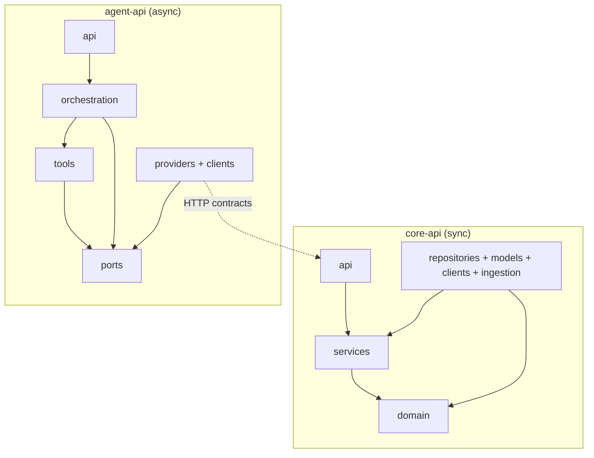
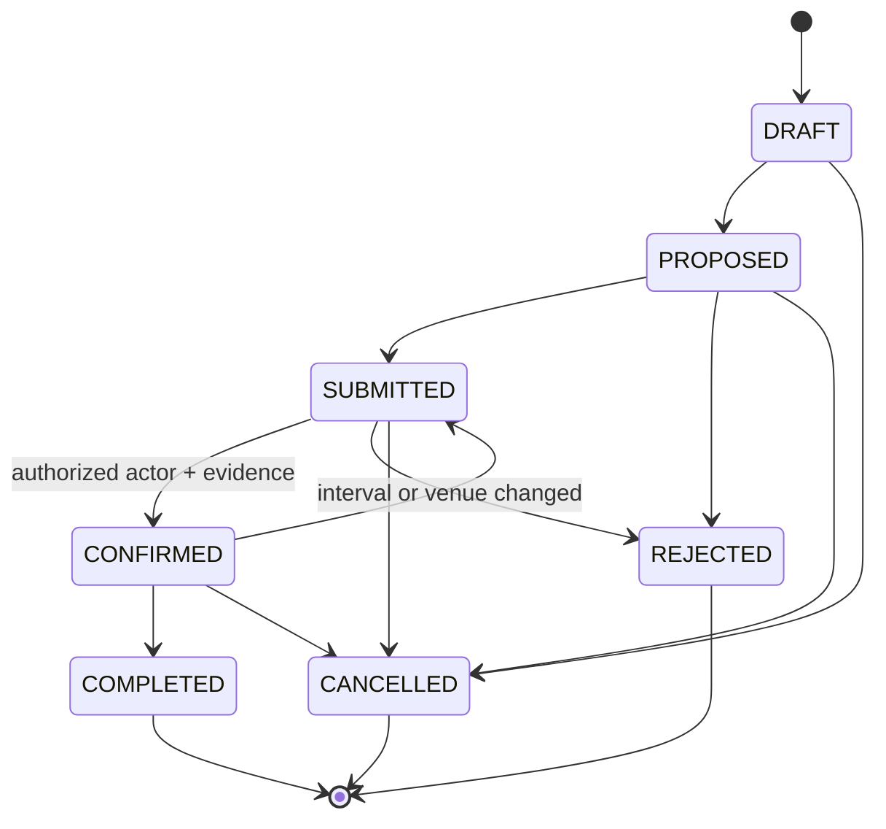
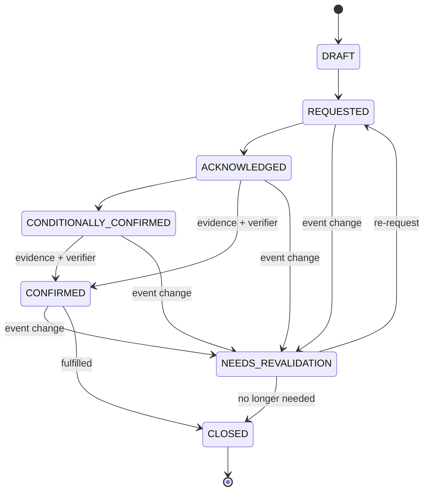
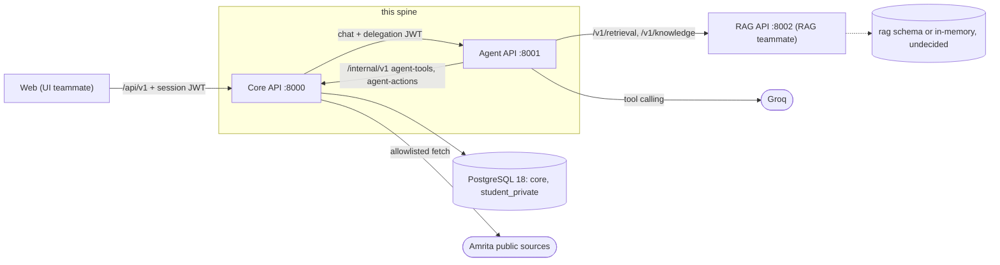
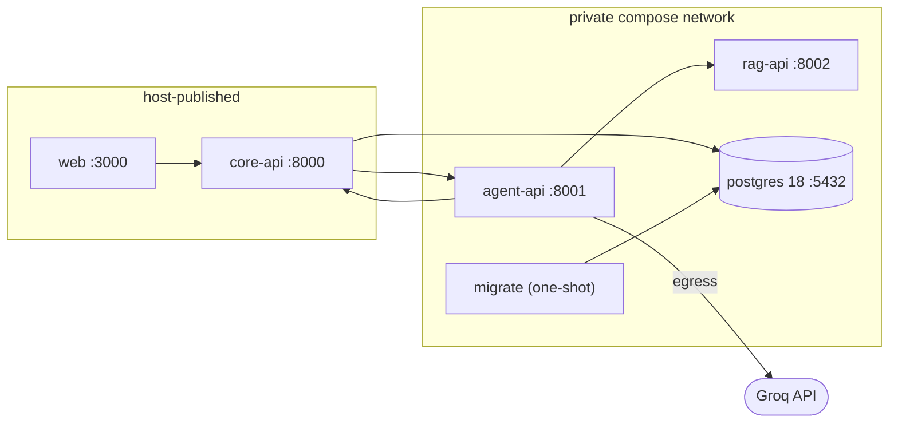
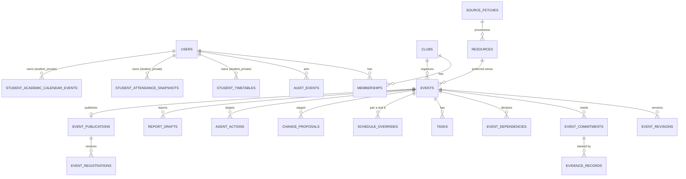

# Architecture Spine — CampusCue Backend and AI

Tags: `[ADOPTED]` = settled by the repo docs or confirmed by the backend/AI owner (2026-10-10, recommended options taken). `[ASSUMPTION]` = open inference, correct in review. None remain.

## Design Paradigm

Two hexagons, one database, typed HTTP between them.

- **Core API** — functional core, imperative shell. Pure `domain/` (intervals, conflicts, lifecycles, impact, risk, authorization) wrapped by `services/` use cases; I/O only in adapters.
- **Agent API** — a bounded orchestrator. A code-owned loop calls allowlisted tools through ports; the LLM is a replaceable provider, never an authority.



Arrows read "may import". Nothing imports `api`. `domain` imports nothing outside the standard library.

## Invariants & Rules

### AD-1 — Core is the only writer of operational state [ADOPTED]

- **Binds:** all
- **Prevents:** a second source of truth; Agent, RAG or Web reading or writing Core tables; authorization enforced only in prompts or UI.
- **Rule:** Only Core processes hold credentials for schemas `core` and `student_private`. Agent, RAG and Web reach operational state exclusively over Core HTTP. Authorization, status transitions and conflict rules are enforced in Core on every request; checks in Web or Agent are advisory.

### AD-2 — Hexagonal layering, mechanically enforced

- **Binds:** core-api, agent-api
- **Prevents:** domain logic in routes or prompts; I/O inside scheduling code; services that cannot run or test alone.
- **Rule:** Core: `domain/` ← `services/` (use cases, and the ports they define) ← `api/`; `repositories/`, `models/`, `clients/`, `ingestion/` implement ports and may import `domain/` and service ports. Agent: `api/` → `orchestration/` → `tools/` → `ports`; `providers/` and `clients/` implement ports. Every outbound dependency (database, Agent, RAG, Groq, clock, id source, HTTP fetch) sits behind a port with a deterministic fake. Import direction is enforced by import-linter (`layers`; `forbidden` including external packages such as fastapi, sqlalchemy and httpx inside `domain/`; `protected` for single-importer modules). Call-level bans on `datetime.datetime.now` and `os.environ` are enforced by ruff `banned-api` in a nested `ruff.toml` under `domain/` and `services/`. Both run in each service's `verify` command.

### AD-3 — Core is synchronous, Agent is asynchronous [ADOPTED]

- **Binds:** core-api, agent-api
- **Prevents:** mixed sync/async session bugs across feature slices.
- **Rule:** Core uses `def` routes and synchronous SQLAlchemy sessions (one per unit of work) and calls Agent with a blocking `httpx.Client` whose timeout exceeds the Agent turn deadline. Agent uses `async def`, `httpx.AsyncClient` and the async Groq client. Neither service mixes the two models in-process.

### AD-4 — One schedule write path under a campus lock

- **Binds:** events, overrides, event confirmation
- **Prevents:** two concurrent requests both passing a stale pre-check; a second code path that writes events around the engine.
- **Rule:** Every write that sets or changes an event's interval, venue or status calls `ScheduleWriteService.commit(...)` and nothing else; rescheduling an existing event is the apply step of AD-14. It opens one transaction, takes `pg_advisory_xact_lock(CAMPUS_SCHEDULE_KEY)` first, loads active events from committed state, runs the pure engine (AD-5, AD-6), then either raises `CONFLICT_DETECTED` or writes event, revision and audit rows (AD-8) in that transaction. Conflict-check endpoints and Agent tools run the same engine without the lock and mark responses `advisory: true`. Event write methods are importable only from `ScheduleWriteService` (import-linter `protected`). The locked transaction makes no network call (no Agent, RAG, LLM or fetch). Enforcement is not claimed until the two-session concurrency test passes.

### AD-5 — Conflicts: independent constraints, severity by stage [ADOPTED]

- **Binds:** scheduling, Agent explanations, Web rendering
- **Prevents:** a single generic "conflict"; tentative proposals being blocked; an override waiving more than its scope; clients re-deriving severity.
- **Rule:** The engine is a pure `evaluate(candidate, others, overrides, policy) -> list[Conflict]`. `others` are all events except the candidate itself, other clubs' DRAFTs (private, never compared), and events REJECTED, CANCELLED or COMPLETED. For each other event, `VENUE_OVERLAP` (same venue, half-open overlap) and `CAMPUS_GAP` (any venue; violated unless `end_a + gap <= start_b` or `end_b + gap <= start_a`) are evaluated independently — one conflict per violated constraint, never short-circuited. Typing by stage: both events CONFIRMED → `VENUE_OVERLAP` / `CAMPUS_GAP_VIOLATION`, severity `blocking`, `override_required: true`; either event not CONFIRMED → `TENTATIVE_OVERLAP`, severity `warning`, `override_required: false`, with an additive `constraint` field naming the violated constraint. Blocking conflicts reject only the transition to CONFIRMED; drafts and proposals always save. Every candidate with a venue also gets one `UNKNOWN_AVAILABILITY` (severity `info`) unless AD-16 says confirmed. `DEPENDENCY_CONFLICT` covers shared resource, organizer or audience. `type` and `severity` are assigned only in the engine; clients render them verbatim. Boundaries are property-tested: exactly 120 minutes passes, 119 fails, back-to-back at one venue passes `VENUE_OVERLAP` but fails `CAMPUS_GAP`.

### AD-6 — Overrides are pair-scoped, admin-only, server-derived [ADOPTED]

- **Binds:** overrides, confirmation, Agent facade
- **Prevents:** a campus-gap exception silently permitting a venue double-booking; client-asserted authority; an `ignore_conflicts` escape hatch.
- **Rule:** `schedule_overrides` rows carry `scope` (`CAMPUS_GAP` | `VENUE_OVERLAP`), the two event ids, non-null `reason`, `authorized_by`, `created_at`, optional `evidence_id`. Created only through an endpoint that `authorize()` (AD-21) allows for CAMPUS_ADMIN; `authorized_by` is set from the authenticated actor and a request body that contains it is rejected 422. An override waives exactly its scope for exactly that pair. The engine drops only the matching conflict. Override and confirm endpoints reject delegated principals (AD-10). No endpoint, tool or parameter bypasses conflicts wholesale.

### AD-7 — Lifecycles are transition tables; confirmation needs authority and evidence [ADOPTED]

- **Binds:** events, commitments, evidence
- **Prevents:** free-form status writes; acknowledgment read as confirmation; organizer claims shown as verified; evidence lost on change.
- **Rule:** Event and commitment state machines are transition tables in `domain/lifecycle`; status changes only through `transition(entity, to, actor, evidence?)`. No request schema has a writable `status`. A move into CONFIRMED requires an authorized actor (AD-21), an `evidence_records` row, and `verified_by`/`verified_at` set from that actor; organizer-supplied claims keep `reported_by` and display as REPORTED until verified. `ACKNOWLEDGED` never implies `CONFIRMED`. Changing a CONFIRMED event's interval or venue demotes it to SUBMITTED and moves dependent commitments to NEEDS_REVALIDATION in the same transaction; evidence is never deleted. Publication is a separate record and never implies approval. Event COMPLETED and administrative closure are separate states.





### AD-8 — Every mutation is one audited, revision-checked, idempotent transaction [ADOPTED]

- **Binds:** all Core mutations
- **Prevents:** state changes without history; lost updates; duplicate writes on retry.
- **Rule:** Mutations run inside `UnitOfWork.mutate(...)`, which in one transaction writes the state change, an `event_revisions` row (previous and new values, actor, reason) when event fields change, and an `audit_events` row (actor, action, entity, outcome, request_id). Handlers never commit. Event-targeting mutations require `expected_revision`; stale → 409 `STALE_REVISION`. Retry-prone mutations accept `Idempotency-Key`, stored in `idempotency_keys(key, actor_id, request_hash, response)`; a replay returns the stored response, a different body under the same key → 422 `IDEMPOTENCY_MISMATCH`.

### AD-9 — The Agent proposes, a human executes

- **Binds:** Agent tools `create_event_draft`, `request_event_change`, `record_commitment`, `create_followup_draft`
- **Prevents:** Agent mutating domain tables; false success claims; double execution; an LLM-granted confirmation.
- **Rule:** The Agent's only write is filing an `AgentAction` into Core's `agent_actions` (type from a closed enum, payload validated against the target operation's schema, `status: PROPOSED`, `requires_human_review: true`, `expected_revision` captured at filing). Core dry-runs the operation at filing and stores conflicts and impact with it; for `REQUEST_EVENT_CHANGE` the dry-run stages the AD-14 change proposal and confirming the action is its apply step. Execution happens only through `POST /api/v1/agent-actions/{action_id}/confirm`, called with the human's own session; Core re-validates inside the AD-4/AD-8 transaction, and confirm is idempotent per action id. Records created on confirm (commitments, drafts) take `reported_by` = the confirming human, never an agent identity. No action type can set a status of CONFIRMED, create an override, or send an external message; there is no `book_event` tool. Agent replies describe actions as proposed, never done.

### AD-10 — The Agent acts as the delegated user through a narrow facade

- **Binds:** Core↔Agent boundary
- **Prevents:** the Agent holding broader authority than the asking user; prompt-injection pivoting to private data; per-tool authorization living in prompts.
- **Rule:** Core's `POST /api/v1/agent/chat` mints a delegation JWT (HS256 via PyJWT; `iss=core`, `aud=agent-tools`, `sub`, `jti`, `req`; expiry ≤ 120 s) and sends it to Agent with the turn. Agent forwards it unmodified as a Bearer token and never decodes or stores it. Core verifies signature, audience and expiry, loads the user and memberships from the database, authorizes each call as that user, and ignores any claim except `sub`. Tokens are minted only for users holding an organizer-class role (ORGANIZER, CLUB_ADMIN, CAMPUS_ADMIN), carry only those permissions, and are rejected on every `/api/v1` route; facade calls are audited with `via = AGENT`. Agent reaches Core only through `/internal/v1/agent-tools/*` (read tools, field-allowlisted, size-capped DTOs) and `/internal/v1/agent-actions` (AD-9); both call the same services as public routes, and no facade route can reach `student_private`, contacts or financial fields.

### AD-11 — Orchestration is bounded and code-owned

- **Binds:** agent-api
- **Prevents:** unbounded loops; guessed inputs; unreviewable behavior; tests that need a paid model.
- **Rule:** A turn runs a loop owned by code with hard limits: `MAX_TOOL_CALLS` 6, `TURN_DEADLINE_S` 20, per-tool timeout 5 s, tool output capped at `MAX_TOOL_BYTES` with an explicit `truncated: true`, one retry on malformed model output then `AGENT_OUTPUT_INVALID`. Tools come from a static allowlist; each declares name, Pydantic input and output models, `effect` (`READ` | `PROPOSE`) and timeout, and arguments are validated before dispatch. A missing critical field (date, start, end, venue) produces a clarifying question, never a default. Every response carries `trace[]` (`tool`, sanitized args, outcome, `latency_ms`, `request_id`). The Agent is stateless between turns: the caller supplies a bounded message history (message count and byte cap) and only AgentActions persist, in Core. Code injects the current time and `Asia/Kolkata` into every turn, and the model returns offset-aware ISO 8601. Tool schemas never expose `access_level` or any other authority-bearing parameter to the model. `AGENT_MODEL_PROVIDER` ∈ {`groq`, `fake`}; `fake` is deterministic and needs no network.

### AD-12 — Untrusted data in, code-assembled grounding out

- **Binds:** agent-api, RAG client
- **Prevents:** prompt injection altering tools or bounds; invented citations; policy answers from model memory.
- **Rule:** Tool results, RAG excerpts and user text enter the prompt only inside delimited untrusted-data blocks in non-system roles and cannot change the allowlist or limits; the RAG `access_level` is derived in code from the delegated user's role, never taken from model output or user text. The model returns `{explanation, evidence_refs[]}`; code keeps only refs that match ids present in this turn's tool results, copies `Citation` objects verbatim from RAG responses (the model never writes citation fields), and removes policy claims without a valid ref. If RAG returns `insufficient_evidence` or is unreachable the reply says so and states no policy from model memory; unreachable maps to `DEPENDENCY_UNAVAILABLE`. Statements about conflicts or impact must reference a Core tool-result id.

### AD-13 — Student-private data stays on the student's own request path [ADOPTED]

- **Binds:** registration-risk check, student feed, registration
- **Prevents:** organizers, Agent, reports, logs or Groq seeing timetable, attendance, calendar or warnings; risk output read as an eligibility decision.
- **Rule:** `student_timetables`, `student_attendance_snapshots` and `student_academic_calendar_events` live in schema `student_private` and are importable only from `services/student_risk.py`, `repositories/student_private.py` and `api/routes/student_events.py` (import-linter allowlist). Every query is scoped `student_id = actor.id` from the session, never from path or body; no organizer or admin route reads them. Risk evaluation is a pure domain function returning advisory warnings of the contract's types; missing data yields `ACADEMIC_DATA_UNAVAILABLE` and registration stays allowed. Student-facing routes return dedicated `StudentEventView` schemas built from a field allowlist, so planning records (commitments, evidence, tasks, overrides, contacts, `reported_by`) cannot reach a student. Organizer-facing registration data carries nothing derived from `student_private` (no warning, no "continued despite warning"); whether registrant identities are visible to organizers is Deferred. These rules hold even when the same person is also an organizer. The data is never passed to Agent, RAG, report assembly or any LLM, and never logged. External mode records `REDIRECTED_TO_EXTERNAL_REGISTRATION`, never completion.

### AD-14 — Change impact is deterministic data, applied in two phases [ADOPTED]

- **Binds:** change-impact, Agent `get_change_impact`
- **Prevents:** the LLM deciding what a change affects; applying a change on stale data; "resolve" altering official status.
- **Rule:** `event_dependencies(event_id, field_path, dependent_kind, dependent_id, rule_id)` binds event fields to commitments and tasks; impact is the join on the changed `field_path`s, computed in `domain/impact` and returned as an `ImpactReport` with a reason and `revalidation_required` per item. Fields that appear in any `event_dependencies.field_path` (at minimum interval, venue and expected attendance) change only through change-proposal apply; the direct edit route accepts non-dependency fields only, so no path skips impact or revalidation. `POST /events/{event_id}/change-proposals` stages a `change_proposals` row (base revision, diff, conflicts, impact) and changes nothing else. Applying is a separate user-authorized call that re-checks revision and conflicts in-transaction (AD-4) and then moves affected commitments to NEEDS_REVALIDATION. The Agent explains an `ImpactReport` and drafts follow-ups only. Closing a task never changes a commitment or approval status.

### AD-15 — Reports: verified facts in, model prose out, human completes

- **Binds:** event and monthly reports, Agent `generate_event_report`
- **Prevents:** invented attendance, photos, speakers, reimbursements or approvals; missing data rendered as zero.
- **Rule:** Core builds `VerifiedFacts` where each field is `{value|null, provenance, state: VERIFIED | REPORTED | MISSING}` and computes `missing_fields`. The Agent drafts prose from `VerifiedFacts` only; model text is stored in draft sections and never written into a fact field. Absent facts stay MISSING. Drafts are editable `report_drafts` rows labeled DRAFT; nothing is exported as certified or approved.

### AD-16 — Availability is UNKNOWN until evidence says otherwise; catalog rows carry provenance [ADOPTED]

- **Binds:** resources, ingestion, conflict engine
- **Prevents:** inferring "free" from an empty calendar or a failed fetch; unattributed catalog data; silent merging of uncertain records.
- **Rule:** `resources.availability_state` ∈ `UNKNOWN | REQUESTED | CONFIRMED`, default `UNKNOWN`. Ingestion and seeds can only write `UNKNOWN`; `REQUESTED`/`CONFIRMED` derive from evidence-backed commitments. Every ingested row carries `source_id`, `source_url`, `collected_at`, `last_checked_at`, `content_hash`, `parser_version`, `freshness_state` (`CURRENT | STALE | HISTORICAL | PARSE_FAILED | REVIEW_REQUIRED | UNKNOWN`); a stale, failed or empty source never changes availability. The fetch adapter rejects any URL not in the allowlist derived from `SOURCE_REGISTRY.md`. Dedupe by source-stable id (ICS UID) first; fuzzy matches open a review task, never merge.

### AD-17 — Time is UTC instants, half-open, clock-injected [ADOPTED]

- **Binds:** all
- **Prevents:** ambiguous local times; off-by-one at boundaries; untestable "now".
- **Rule:** Persist `timestamptz` in UTC; intervals are `[start_at, end_at)` with a DB `CHECK (start_at < end_at)`. The API accepts only offset-aware ISO 8601 (naive → 422) and returns offset-aware values; `Asia/Kolkata` conversion happens only in `api` schemas. Domain and services take aware datetimes and an injected `Clock`; `datetime.datetime.now` is banned there by ruff `banned-api` (AD-2). The gap in minutes is a Setting (default 120) read once per write, and any message citing it calls it a CampusCue planning rule.

### AD-18 — Contracts are authoritative and generated, never hand-synced

- **Binds:** all cross-service shapes
- **Prevents:** producer/consumer drift; teams blocked on each other; silent enum or field renames.
- **Rule:** Core and Agent export OpenAPI to `contracts/core-api.openapi.yaml` and `contracts/agent-api.openapi.yaml` by script; `verify` fails when the committed file differs from regenerated output. Cross-service shapes (error envelope, conflict, `AgentAction`, `Citation`, `ImpactReport`, `VerifiedFacts`) have JSON Schemas and examples under `contracts/` that each service's contract tests validate producer output and consumer fakes against. Enums are defined once in the producer's `domain/enums.py`; changes are additive, and the Agent's clients raise a typed error on an unknown value rather than ignoring it. A contract change lands before dependent code (AGENTS.md). No runtime library is shared between services. Existing docs this spine contradicts are corrected in the change that implements the affected slice.

### AD-19 — Request identity, errors, health and internal calls behave identically everywhere

- **Binds:** core-api, agent-api (RAG asked to align)
- **Prevents:** untraceable requests; clients parsing different error shapes; a down LLM making Core look unhealthy; open internal endpoints.
- **Rule:** Middleware reads or creates `X-Request-ID`, echoes it, and clients forward it. Every non-2xx response is `{code, message, details, request_id}` with SCREAMING_SNAKE codes from `contracts/`; unhandled exceptions return `INTERNAL_ERROR` with no stack or body. Logs are structlog JSON (`request_id`, `actor_id`, route, status, latency) and never contain bodies, tokens, keys, student-private fields or document text. `/health` is process liveness; `/ready` for Core is database reachable and migration head applied — Agent/RAG/LLM state appears only as informational fields; for Agent it is a configured provider. Outside `local`, every service-to-service call also carries `X-Internal-Key` (constant-time compare). Core wraps Agent or RAG failure as 503 `DEPENDENCY_UNAVAILABLE` while scheduling and CRUD keep working.

### AD-20 — One Postgres, owned schemas, linear migrations

- **Binds:** persistence
- **Prevents:** two services owning one table; migration forks; schema changes that run at app start in several workers.
- **Rule:** PostgreSQL 18 holds schemas `core` and `student_private` (Core-owned) and `rag` (RAG-owned; Core never reads it). Each service connects with its own database role granted only its schemas. Core migrations are Alembic, one linear chain, files `NNNN_slug.py`, version table `alembic_version_core`; `verify` asserts exactly one head; applied migrations are never edited. Migrations run through an explicit `migrate` one-shot before the API starts, never in app startup. JSON columns hold only opaque payloads (AgentAction payload, trace), never fields the engine or impact rules read. `event_revisions`, `audit_events` and `evidence_records` have no update or delete code path; cancellation is a status.

### AD-21 — One authorization decision point; roles come from the database

- **Binds:** all Core routes and facade
- **Prevents:** authority from client-supplied ids or token claims; role logic scattered across handlers.
- **Rule:** `domain/authz.authorize(actor, action, resource_ctx) -> Decision` is the only place roles are interpreted; routes and services call it and tests table-drive it. Roles `ORGANIZER`, `CLUB_ADMIN`, `CAMPUS_ADMIN`, `STUDENT` are derived per request from user and membership rows, never from token claims or request-supplied `authorized_by`, `club_id` or `role`. Until stakeholders decide (PLAN open decision 3), only CAMPUS_ADMIN may confirm bookings or create overrides; widening it is a change to `authz` alone. Hackathon authentication is a Core-issued session JWT from a demo-login for seeded synthetic personas, available only when `APP_ENV` ∈ {local, test, demo}; real SSO plugs in behind the same actor resolution.

### AD-22 — Configuration, secrets and external egress

- **Binds:** all services
- **Prevents:** committed secrets; LLM credentials in Core; private data leaving through a provider; real data mixed with demo data.
- **Rule:** Each service reads typed `pydantic-settings` from environment; `.env` is gitignored and `.env.example` holds placeholders only. `APP_ENV` ∈ {`local`, `test`, `demo`}; seeds and demo-login refuse any other value. The Groq key exists only in Agent (and in RAG for its own calls); Core holds no LLM credentials. Core alone holds `SESSION_SIGNING_KEY` and `DELEGATION_SIGNING_KEY` (distinct); Agent holds neither. Groq is an egress boundary: Agent sends only facade-shaped content (AD-10). Seed rows set `is_synthetic = true`, surfaced as `synthetic` on event, resource and student responses.

### AD-23 — Cross-club conflicts are projected, not leaked [ADOPTED]

- **Binds:** conflict-check, tentative calendar, Agent facade
- **Prevents:** one club learning another's private plans; each endpoint redacting differently; Agent explanations exposing hidden fields.
- **Rule:** The engine's raw `Conflict` never crosses the API. A `ConflictProjection` in `services/` shapes every conflict for the requester: for another club's non-DRAFT event it exposes only the minimal shared fields (event name, organizing club, window, preferred venue, status, audience tags) and omits commitments, evidence, approvals, contacts and internal notes; for the requester's own club it exposes full detail. Public routes and the Agent facade use this single projection. Until PLAN open decision 8 is settled, DRAFT is private and PROPOSED-or-later events share the minimal field set.

## Consistency Conventions

| Concern | Convention |
| --- | --- |
| Naming | Tables snake_case plural; routes plural nouns under `/api/v1`, internal under `/internal/v1`; tools snake_case verbs matching Plan 03; enum values SCREAMING_SNAKE; Python modules per the Plan 01 layout |
| Ids and enums | UUIDv4 for entities; RAG `evidence_id` is an opaque string; enums defined once in producer `domain/enums.py` and exported via OpenAPI |
| Errors and statuses | Envelope per AD-19; blocking conflict on write → 409 `CONFLICT_DETECTED` with conflict objects in `details`; stale → 409 `STALE_REVISION`; validation → 422; denied → 403 `FORBIDDEN`; downstream down → 503 `DEPENDENCY_UNAVAILABLE` |
| Lists | `limit` (default 50, max 200) and `offset`; responses never expose ORM rows |
| Environments | `local` (compose, dev ports published), `test` (pytest, Postgres via testcontainers, fakes), `demo` (compose on one host, synthetic seed, demo-login on) |
| Testing layout | `tests/unit` (pure, no DB), `tests/integration` (real Postgres), `tests/contract`; each service has one `verify` command (pytest, ruff, mypy, import-linter, plus contract-drift and single-head checks in Core) |
| Commits and branches | Per AGENTS.md: 2–3 file commits, contract-first, work on `backend-ai`, never `main` |

## Stack

| Name | Version |
| --- | --- |
| Python | 3.12 (3.12.15; supported to 2028-10) |
| PostgreSQL | 18 (18.6; supported to 2030-11) |
| FastAPI | 0.143.0 |
| Pydantic | 2.14.0 |
| pydantic-settings | 2.15.0 |
| SQLAlchemy | 2.1.4 |
| Alembic | 1.20.0 |
| psycopg | 3.3.6 |
| uvicorn | 0.54.0 |
| httpx | 0.28.1 |
| groq (SDK) | 1.7.0 |
| Groq model | llama-3.3-70b-versatile (production; tool use and JSON object mode) |
| PyJWT | 2.15.1 |
| structlog | 26.1.0 |
| pytest | 9.1.1 |
| pytest-asyncio | 1.4.0 |
| hypothesis | 6.168.5 |
| respx | 0.23.1 |
| testcontainers | 4.15.0 |
| ruff | 0.17.0 |
| mypy | 2.4.0 |
| import-linter | 2.15 |
| httpx2 | 2.13.1 (tests only: Starlette's `TestClient` deprecates `httpx`; runtime stays on httpx 0.28.1) |
| uv | 0.12.22 |

## Structural Seed





Local development may also publish 8001, 8002 and 5432 to localhost; the `demo` environment does not.



```text
Genesis-womm/
  contracts/                 # OpenAPI exports, JSON Schemas, examples (authoritative)
  services/
    core-api/
      app/
        domain/              # pure: intervals, scheduling, lifecycle, impact, risk, authz, enums
        services/            # use cases, ScheduleWriteService, UnitOfWork, ports
        api/routes/          # /api/v1 routes; internal/ for /internal/v1 facade
        schemas/             # wire DTOs (api and clients only)
        models/ repositories/ clients/ ingestion/   # adapters
        settings.py main.py
      migrations/            # Alembic NNNN_slug.py
      tests/{unit,integration,contract}/
    agent-api/
      app/
        api/routes/ orchestration/ tools/ ports/
        providers/           # groq, fake
        clients/             # core_api, rag_api
        schemas/ settings.py main.py
      tests/
    rag-api/                 # external (RAG teammate)
  apps/web/                  # external (UI teammate)
  docker-compose.yml  .env.example  .gitignore
```

## Capability → Architecture Map

| Capability / Area | Lives in | Governed by |
| --- | --- | --- |
| 1 Tentative proposals, cross-club overlap | core `domain/scheduling`, `services/schedule_write` | AD-4, AD-5, AD-17 |
| 2 Sourced resource explorer | core `models`, `ingestion/` | AD-16 |
| 3 OSA handbook assistant | agent `tools/search_campus_policy` → RAG | AD-10, AD-12 |
| 4 Commitment and evidence tracking | core `services`, `domain/lifecycle` | AD-7, AD-8 |
| 5 Deterministic conflict detection | core `domain/scheduling` | AD-4, AD-5, AD-6 |
| 6 Change-impact analysis | core `domain/impact`; agent explains | AD-14, AD-9 |
| 7 Editable reports | core assembly; agent drafts | AD-15 |
| 8 Operational memory and handover | not in MVP | Deferred |
| 9 Student feed and registration modes | core `api/routes/student_events` | AD-13, AD-21 |
| 10 Private registration-risk check | core `services/student_risk`, `domain/risk` | AD-13 |
| Agent chat, plan-event, analyze-change | agent `api/routes`, `orchestration/` | AD-9 to AD-12 |

## Deferred

- **Hosting provider for the demo** — compose on one host is assumed; revisit when the demo venue and network are known.
- **Real SSO and student authentication** — blocked on an institutional decision; the actor-resolution seam in AD-21 absorbs it.
- **Official validity of the 120-minute gap** — stays a Setting and a labeled planning rule until stakeholders confirm.
- **Roles for confirmation and override beyond CAMPUS_ADMIN** — PLAN open decision 3.
- **Registrant-identity visibility to organizers and registration form fields** — PLAN open decision 9; AD-13 already bars anything derived from `student_private`.
- **Persisting chat history** — the Agent is stateless in the MVP (AD-11); add only if the demo needs cross-session memory.
- **Same-venue GiST exclusion constraint on CONFIRMED events** — optional backstop; revisit if the concurrency test finds a gap or pair-scoped overrides prove modelable in a constraint.
- **Google Calendar OAuth, institutional attendance API, outbound notifications** — out of MVP per PLAN.
- **Metrics, tracing, rate limiting, backups** — logs only for the hackathon; revisit before any real pilot.
- **CI provider wiring** — `verify` is the contract; wiring it into GitHub Actions can wait without letting units diverge.
- **RAG internals (storage, retrieval, graph components) and Web framework** — external; the spine only constrains the contract surface (AD-12, AD-18, AD-19).
- **Agent evaluation corpus and prompt text** — feature-level; bounded by AD-11 and AD-12.

## Open Items

- AD-3, AD-5, AD-6, AD-7 (demotion), AD-21 (roles) and AD-23 (cross-club sharing) were confirmed by the backend/AI owner on 2026-10-10 by taking the recommended option. Web and RAG owners have not signed off; AD-5 severity, AD-21 roles and AD-23 projection change what Web renders, so they are the ones to show them.
- Alembic 1.20 with SQLAlchemy 2.1.4 on PostgreSQL 18 is verified: upgrade, idempotent re-run, downgrade, `alembic check` and the `DATABASE_URL`-only one-shot all pass (`services/core-api/tests/integration/test_migrations.py`).
- Groq strict `json_schema` support for `llama-3.3-70b-versatile` is unconfirmed; AD-11 relies on tool use plus Pydantic validation instead. Confirm when the Groq provider lands (Plan 03).
- RAG asked to adopt `X-Request-ID` and the error envelope and to state its storage choice (AD-19).
